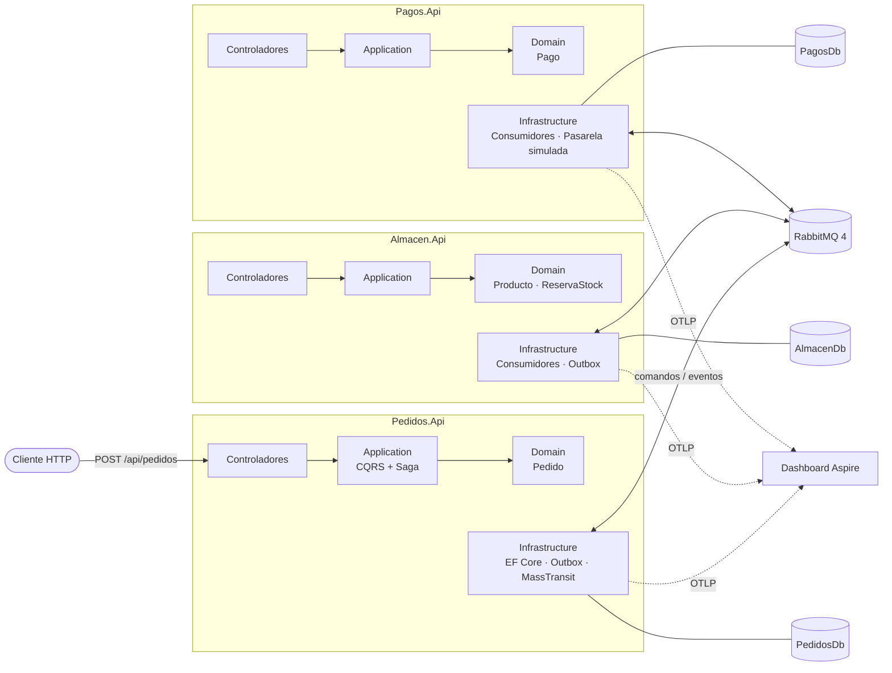
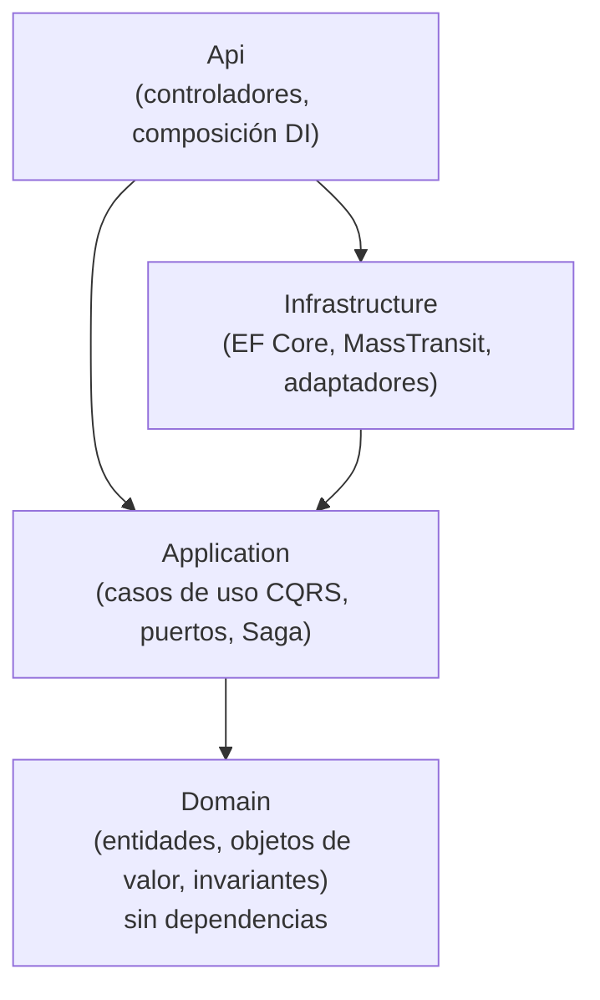
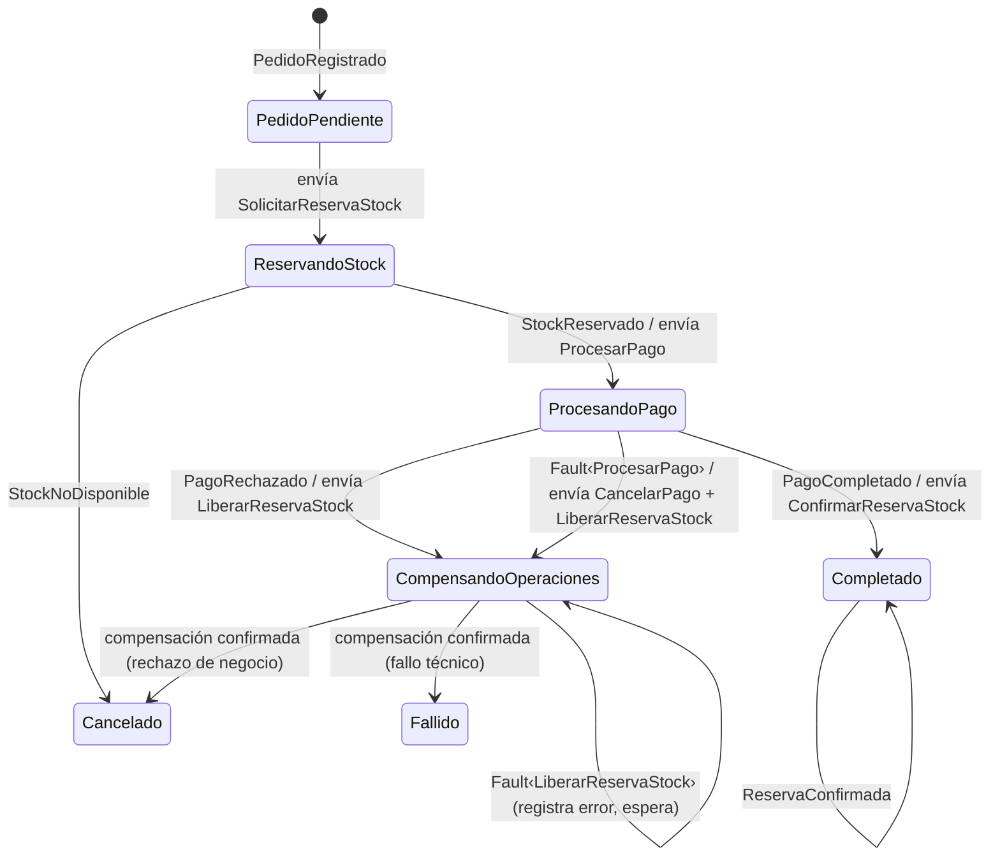
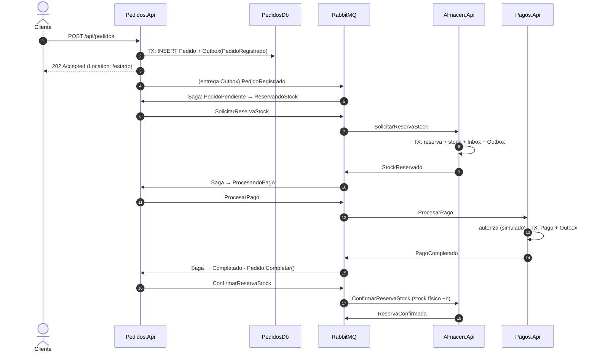
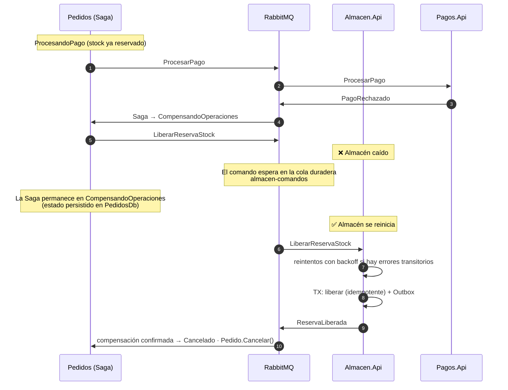
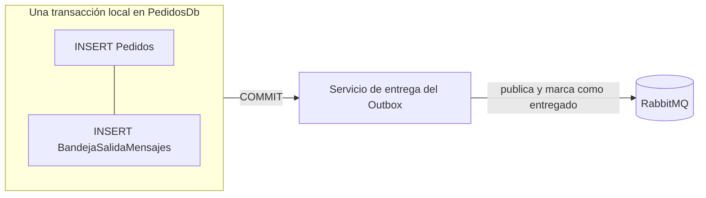

# Transacciones distribuidas con microservicios .NET 10

> Prueba de concepto didáctica: cómo completar una compra que atraviesa **tres microservicios con tres bases de datos** sin una transacción SQL global, manteniendo la consistencia mediante **Saga orquestada, Transactional Outbox, consumidores idempotentes y transacciones compensatorias**.

     

---

## Índice

1. [Objetivo](#1-objetivo)
2. [El problema](#2-el-problema)
3. [Arquitectura](#3-arquitectura)
4. [Tecnologías](#4-tecnologías)
5. [Responsabilidades de cada microservicio](#5-responsabilidades-de-cada-microservicio)
6. [Contratos de integración](#6-contratos-de-integración)
7. [El patrón Saga](#7-el-patrón-saga)
8. [Transactional Outbox](#8-transactional-outbox)
9. [Idempotencia](#9-idempotencia)
10. [Reintentos, DLQ y correlación](#10-reintentos-dead-letter-queue-y-correlación)
11. [Ejecución con Docker Compose](#11-ejecución-con-docker-compose)
12. [Ejecución con .NET Aspire](#12-ejecución-con-net-aspire)
13. [Ejemplos de llamadas HTTP](#13-ejemplos-de-llamadas-http)
14. [Escenarios de fallo](#14-escenarios-de-fallo)
15. [Pruebas](#15-pruebas)
16. [Decisiones arquitectónicas](#16-decisiones-arquitectónicas)
17. [Estructura de la solución](#17-estructura-de-la-solución)

---

## 1. Objetivo

Demostrar, con código de calidad de producción y explicaciones, cómo coordinar una operación de negocio distribuida — *comprar un producto* — en la que intervienen **Pedidos**, **Almacén** y **Pagos**, de forma que:

- cada servicio es **propietario exclusivo** de sus datos;
- **no existe** una transacción distribuida (ni MSDTC, ni 2PC, ni una base de datos compartida);
- el sistema converge siempre a un estado **consistente** (pedido completado y cobrado, o cancelado sin stock retenido ni cargos), incluso con caídas de servicios, mensajes duplicados y errores transitorios.

## 2. El problema

En un monolito, «reservar stock + cobrar + confirmar el pedido» es una transacción `BEGIN … COMMIT`. Al separar el sistema en microservicios con su propia base de datos, ese `COMMIT` único desaparece:

| Riesgo | Ejemplo |
|---|---|
| **Escritura dual** | Pedidos guarda el pedido pero se cae antes de publicar el mensaje → el pedido nunca se procesa. |
| **Mensajes duplicados** | RabbitMQ garantiza *at-least-once*: una reentrega podría reservar o cobrar dos veces. |
| **Fallo parcial** | El stock está reservado, pero el pago se rechaza → hay que **deshacer** algo que ya se confirmó en otra base de datos. |
| **Servicio caído** | Almacén no está disponible cuando debe liberar el stock → la compensación no puede perderse. |

La solución combina varios patrones, cada uno resolviendo uno de estos riesgos:

| Riesgo | Patrón |
|---|---|
| Escritura dual | **Transactional Outbox** |
| Duplicados | **Idempotent Consumer** (Inbox + restricciones únicas + idempotencia de negocio) |
| Fallo parcial | **Saga orquestada** + **Compensating Transactions** |
| Servicio caído / errores transitorios | Colas duraderas + **Retry** con backoff + **Dead Letter Queue** |
| Seguimiento | **Correlation ID** + trazas distribuidas OpenTelemetry |

## 3. Arquitectura

### Vista de contenedores



Las tres bases de datos viven en la misma instancia de SQL Server 2022 por comodidad local, pero **cada servicio solo conoce la cadena de conexión de la suya**: no hay consultas cruzadas ni transacciones compartidas.

### Clean Architecture dentro de cada servicio



- **Domain** no depende de nada. Las invariantes (no reservar más de lo disponible, no completar un pedido cancelado…) se protegen aquí.
- **Application** define los casos de uso (comandos y consultas) y los **puertos** (`IPedidoRepositorio`, `IAutorizadorPagos`…). Devuelve `Resultado<T>` (Result Pattern).
- **Infrastructure** implementa los puertos: EF Core, Outbox, consumidores de mensajes y la pasarela simulada.
- **Api** es la raíz de composición: controladores delgados que solo traducen HTTP ↔ despachador.

### CQRS sin librerías externas

`Compartido.Aplicacion` incluye un despachador propio y tipado (sin MediatR):

```csharp
public interface IManejadorComando<in TComando, TResultado> where TComando : IComando<TResultado>
{
    Task<Resultado<TResultado>> ManejarAsync(TComando comando, CancellationToken cancellationToken);
}

// En un controlador:
var resultado = await despachador.EnviarAsync(new CrearPedidoComando(...), cancellationToken);
return resultado.EsCorrecto ? AcceptedAtAction(...) : this.Problema(resultado.Error);
```

El despachador cierra el tipo genérico del manejador **una vez por tipo de petición** mediante un envoltorio fuertemente tipado guardado en caché, sin `dynamic` ni reflexión en cada llamada. Los consumidores de RabbitMQ usan el mismo despachador, de modo que HTTP y mensajería comparten exactamente los mismos casos de uso.

## 4. Tecnologías

| Tecnología | Uso |
|---|---|
| **.NET 10 LTS / C# 14** | Plataforma. Se aprovechan *extension members* (`extension(IServiceCollection servicios) { … }`), constructores primarios, expresiones de colección y `Guid.CreateVersion7()`. |
| **ASP.NET Core Web API** | Controladores, ProblemDetails (RFC 9457), `IExceptionHandler`, OpenAPI. |
| **Entity Framework Core 10** | Persistencia, *owned types*, *complex types*, `UseAsyncSeeding`, concurrencia optimista (`rowversion`). |
| **SQL Server 2022** | Tres bases de datos lógicas. |
| **RabbitMQ 4 + Management** | Transporte de mensajes, colas duraderas, cola de errores. |
| **MassTransit 8.5** | Máquina de estados de la Saga, Outbox/Inbox EF Core, reintentos, topología RabbitMQ. |
| **.NET Aspire 13** | Orquestación local y dashboard de recursos, logs y trazas. |
| **OpenTelemetry** | Trazas distribuidas, métricas y logs estructurados exportados por OTLP. |
| **xUnit · NSubstitute · Testcontainers** | Pruebas unitarias, dobles de prueba y pruebas de integración con contenedores reales. |

> **Por qué MassTransit 8.5:** a partir de la versión 9 MassTransit pasa a licencia comercial. La rama 8.5.x es Apache 2.0, estable y totalmente funcional sobre .NET 10. Las versiones de todos los paquetes están centralizadas en `Directory.Packages.props`.

## 5. Responsabilidades de cada microservicio

### Pedidos.Api — orquestador
- Recibe y valida las solicitudes de compra; crea el agregado `Pedido`.
- Aloja la **máquina de estados** `GestorSagaPedidos`, que coordina reserva, pago y compensaciones.
- Persiste el pedido **y** el estado de la Saga en `PedidosDb`.
- Expone el seguimiento del proceso (`GET /api/pedidos/{id}/estado`).

### Almacen.Api — inventario
- Gestiona `Producto` (stock físico / reservado / disponible) y `ReservaStock`.
- Reserva **todo o nada**, confirma reservas tras el cobro y las libera como compensación.
- Garantiza como máximo una reserva por pedido (índice único) y que el stock nunca queda negativo (restricción `CHECK` + concurrencia optimista).

### Pagos.Api — cobros (simulados)
- Gestiona `Pago` con su ciclo `Pendiente → Completado | Rechazado → Cancelado | Reembolsado`.
- La pasarela está simulada (`SimuladorAutorizacionPagos`): rechaza importes superiores a `ImporteMaximoAutorizado` y simula una caída técnica para `ImporteFalloTecnico`.
- Garantiza como máximo un pago por pedido; registra **cancelaciones preventivas** para bloquear cobros tardíos.

## 6. Contratos de integración

Los contratos viven en `Contratos.Integracion`, una biblioteca **sin dependencias** con *records* planos. Ningún servicio comparte entidades de dominio: cada uno traduce el contrato a su propio modelo.

Todos los mensajes incluyen `CorrelationId` (el identificador del proceso, igual al `PedidoId`) y los datos de negocio imprescindibles.

### Comandos (`Send` a una cola concreta)

| Comando | Envía | Consume | Cola |
|---|---|---|---|
| `SolicitarReservaStock` | Pedidos (Saga) | Almacén | `almacen-comandos` |
| `ConfirmarReservaStock` | Pedidos (Saga) | Almacén | `almacen-comandos` |
| `LiberarReservaStock` ↩️ | Pedidos (Saga) | Almacén | `almacen-comandos` |
| `ProcesarPago` | Pedidos (Saga) | Pagos | `pagos-comandos` |
| `CancelarPago` ↩️ | Pedidos (Saga) | Pagos | `pagos-comandos` |

### Eventos (`Publish`, suscripción por tipo)

| Evento | Publica | Consume |
|---|---|---|
| `StockReservado` | Almacén | Pedidos (Saga) |
| `StockNoDisponible` | Almacén | Pedidos (Saga) |
| `ReservaConfirmada` | Almacén | Pedidos (Saga) |
| `ReservaLiberada` | Almacén | Pedidos (Saga) |
| `PagoCompletado` | Pagos | Pedidos (Saga) |
| `PagoRechazado` | Pagos | Pedidos (Saga) |
| `PagoCancelado` | Pagos | Pedidos (Saga) |
| `PedidoRegistrado` *(interno)* | Pedidos (API, vía Outbox) | Pedidos (Saga) |
| `Fault<ProcesarPago>`, `Fault<LiberarReservaStock>`, `Fault<CancelarPago>` | MassTransit, al agotar reintentos | Pedidos (Saga) |

↩️ = acción compensatoria.

> **Comandos frente a eventos.** Un comando tiene un único destinatario y expresa una intención («reserva»), así que se *envía* a una cola explícita. Una ventaja decisiva: si el destinatario está caído, **la cola duradera retiene el comando** hasta que vuelva. Un evento expresa un hecho («stock reservado») y se *publica* para quien quiera escucharlo.

## 7. El patrón Saga

Una **Saga** sustituye una transacción ACID global por una secuencia de **transacciones locales**, una por servicio. Si un paso falla, se ejecutan **transacciones compensatorias** que deshacen semánticamente los pasos anteriores (liberar el stock no es un `ROLLBACK`: es una nueva operación de negocio).

Se usa **orquestación**: un único componente (`GestorSagaPedidos`, en Pedidos) decide qué ocurre a continuación. Frente a la coreografía, el flujo es explícito, está en un solo lugar y es fácil de razonar y probar.

### Estados de la Saga



| Estado | Significado |
|---|---|
| `PedidoPendiente` | Estado de entrada: la instancia se crea con los datos del pedido; se abandona en la misma transacción al enviar el primer comando. |
| `ReservandoStock` | Esperando la respuesta de Almacén. |
| `ProcesandoPago` | Stock reservado; esperando la respuesta de Pagos. |
| `CompensandoOperaciones` | Se han enviado compensaciones; **no se sale de aquí** hasta confirmarlas todas. |
| `Completado` | Final: cobrado; se consolida la reserva. |
| `Cancelado` | Final: causa de negocio (sin stock o pago rechazado), compensaciones confirmadas. |
| `Fallido` | Final: fallo técnico no recuperable del pago, compensaciones confirmadas. |

### Estado del pedido ≠ estado de la Saga

| | Estado del pedido (`EstadoPedido`) | Estado de la Saga |
|---|---|---|
| Audiencia | El cliente / el negocio | El orquestador |
| Valores | `Pendiente`, `Completado`, `Cancelado`, `Fallido` | Los siete anteriores |
| Durante el proceso | Siempre `Pendiente` | Cambia en cada paso |

`GET /api/pedidos/{id}/estado` devuelve ambos para hacer visible la diferencia.

### Escenario A — secuencia satisfactoria



### Escenario C/D — secuencia con compensación y caída de Almacén



## 8. Transactional Outbox

**Problema (escritura dual):** guardar en la base de datos y publicar en RabbitMQ son dos operaciones en dos sistemas distintos. Si el proceso cae entre ambas, se pierde el mensaje (o se publica algo que no se guardó).

**Solución:** el mensaje no se envía directamente al broker; se **inserta en una tabla de la misma base de datos**, en la **misma transacción local** que el cambio de negocio. Un proceso en segundo plano lee esa tabla y entrega los mensajes al broker.



En esta PoC se usa la integración de **MassTransit con EF Core** en sus dos modalidades:

- **Bus Outbox** (Pedidos.Api, al crear el pedido): fuera de un consumidor, el `IPublishEndpoint` con ámbito escribe en `BandejaSalidaMensajes` en lugar de enviar.
- **Consumer Outbox** (los tres servicios): los mensajes que publica un consumidor se guardan junto a sus cambios de negocio y solo salen cuando la transacción confirma. Incluye un **Inbox** (`BandejaEntradaEstado`) que registra el `MessageId` de cada mensaje procesado.

En la Saga, un único `SaveChanges` confirma a la vez: el estado de la Saga (`SagasPedido`), el cambio del pedido (`Pedidos`) y los comandos salientes.

## 9. Idempotencia

RabbitMQ entrega *al menos una vez*, así que cada consumidor debe tolerar duplicados. Hay tres capas de defensa:

| Capa | Mecanismo | Protege frente a |
|---|---|---|
| **1. Inbox** | MassTransit registra el `MessageId` en `BandejaEntradaEstado` | Reentregas del broker del **mismo** mensaje. |
| **2. Idempotencia de negocio** | El manejador busca primero por `PedidoId`; si ya existe reserva/pago, devuelve el resultado existente | El **mismo** comando reenviado con otro `MessageId`. |
| **3. Restricción única** | `UX_ReservasStock_IdPedido`, `UX_Pagos_IdPedido` | Dos duplicados procesados **en paralelo**: uno falla, se reintenta y cae en la capa 2. |

Además, las operaciones compensatorias son idempotentes por diseño:

- `ServicioReservaStock.Liberar` devuelve `false` sin tocar el stock si la reserva ya está liberada → **nunca se libera dos veces**.
- `Pago.Cancelar` no hace nada en estados finales.
- Las reservas **rechazadas se persisten**: un `SolicitarReservaStock` duplicado recibe la misma respuesta aunque entretanto haya entrado stock.
- La Saga ignora eventos duplicados en los estados en que ya no son relevantes (`Ignore(...)`).

## 10. Reintentos, Dead Letter Queue y correlación

- **Retry con backoff exponencial**: configurable en `Mensajeria:Reintentos` (por defecto 5 intentos, de 1 s a 30 s). Las `ExcepcionDominio` **no se reintentan**: son errores permanentes.
- **Dead Letter Queue**: agotados los reintentos, MassTransit mueve el mensaje a `<cola>_error` (p. ej. `almacen-comandos_error`) conservando las cabeceras con la excepción, y publica `Fault<T>`. La Saga escucha esos `Fault` para **registrar** el problema (`UltimoError`, `FallosCompensacion`) sin dar la compensación por terminada. Desde la consola de RabbitMQ se puede mover el mensaje de vuelta a su cola cuando el problema se haya corregido.
- **Concurrencia optimista** en la Saga (`rowversion`): si dos eventos del mismo pedido llegan a la vez, uno falla por conflicto y se reintenta sobre el estado actualizado.
- **Correlation ID**: todos los contratos llevan `CorrelationId`; los consumidores abren un ámbito de log con `CorrelationId` y `PedidoId`; la API acepta/devuelve `X-Correlation-ID`; y MassTransit propaga el contexto W3C (`traceparent`) en las cabeceras, de modo que **una sola traza** recorre los tres servicios en el dashboard de Aspire.

## 11. Ejecución con Docker Compose

Requisitos: Docker Desktop (o Docker Engine + Compose v2).

```bash
cp .env.example .env          # edite las contraseñas
docker compose up --build
```

| Recurso | URL |
|---|---|
| Pedidos.Api | http://localhost:5001 |
| Almacen.Api | http://localhost:5002 |
| Pagos.Api | http://localhost:5003 |
| Consola de RabbitMQ | http://localhost:15672 (usuario/clave de `.env`) |
| Dashboard de Aspire (trazas y logs) | http://localhost:18888 |
| SQL Server | `localhost,14333` (usuario `sa`) |

Cada API expone `/health` (BD + bus) y `/alive`. SQL Server y RabbitMQ usan *healthchecks* y las APIs arrancan con `depends_on: condition: service_healthy`. El esquema de cada base de datos y el catálogo de productos se crean automáticamente al arrancar.

```bash
docker compose down        # detiene (los volúmenes conservan datos y mensajes)
docker compose down -v     # detiene y borra los datos
```

## 12. Ejecución con .NET Aspire

Requisitos: SDK de .NET 10 y Docker. En Windows, **Visual Studio 2026** (Visual Studio 2022 no admite proyectos .NET 10), JetBrains Rider o VS Code con C# Dev Kit.

```bash
dotnet run --project src/AppHost/DistributedTransactions.AppHost
```

O establezca `DistributedTransactions.AppHost` como proyecto de inicio en el IDE y pulse F5. Se abrirá el **dashboard de Aspire**, desde el que se ven los recursos (SQL Server, las tres bases de datos, RabbitMQ con su consola y las tres APIs), los logs estructurados, las métricas y las **trazas distribuidas**.

Aspire genera las contraseñas de SQL Server y RabbitMQ y las guarda en los *user-secrets* del AppHost; nada sensible se versiona. Los contenedores son persistentes, lo que permite detener una API desde el dashboard, generar pedidos y volver a arrancarla para observar cómo la Saga continúa.

> **Sin duplicación de configuración:** Aspire y Docker Compose inyectan las mismas claves (`ConnectionStrings__PedidosDb`, `…AlmacenDb`, `…PagosDb`, `ConnectionStrings__rabbitmq`, `OTEL_EXPORTER_OTLP_ENDPOINT`). Los servicios no saben quién los arranca.

## 13. Ejemplos de llamadas HTTP

Cada API incluye un archivo `.http` utilizable desde el IDE. Productos del catálogo de demostración:

| Producto | Id | Stock inicial |
|---|---|---|
| Teclado mecánico | `11111111-1111-1111-1111-111111111111` | 100 |
| Ratón inalámbrico | `22222222-2222-2222-2222-222222222222` | 50 |
| Monitor 4K 27" | `33333333-3333-3333-3333-333333333333` | 10 |
| Edición limitada | `44444444-4444-4444-4444-444444444444` | 0 |

**Crear un pedido (escenario A):**

```bash
curl -i -X POST http://localhost:5001/api/pedidos \
  -H "Content-Type: application/json" -H "X-Correlation-ID: demo-001" \
  -d '{
        "clienteId": "aaaaaaaa-0000-0000-0000-000000000001",
        "moneda": "EUR",
        "lineas": [{ "productoId": "11111111-1111-1111-1111-111111111111", "cantidad": 2, "precioUnitario": 49.90 }]
      }'
```

```http
HTTP/1.1 202 Accepted
Location: http://localhost:5001/api/pedidos/0193.../estado
X-Correlation-ID: demo-001

{ "pedidoId": "0193...", "estado": "Pendiente", "total": 99.80, "moneda": "EUR" }
```

**Seguir el proceso:**

```bash
curl http://localhost:5001/api/pedidos/{pedidoId}/estado
```

```json
{
  "pedidoId": "0193...",
  "estadoPedido": "Completado",
  "estadoSaga": "Completado",
  "reservaId": "0193...",
  "pagoId": "0193...",
  "motivo": null,
  "ultimoErrorSaga": null,
  "fechaActualizacionSagaUtc": "2026-11-05T10:15:02.117+00:00"
}
```

**Consultar los otros servicios:**

```bash
curl http://localhost:5002/api/productos/11111111-1111-1111-1111-111111111111/disponibilidad
curl "http://localhost:5002/api/reservas?pedidoId={pedidoId}"
curl "http://localhost:5003/api/pagos?pedidoId={pedidoId}"
```

**Errores** — todos en formato ProblemDetails:

```json
{
  "type": "https://tools.ietf.org/html/rfc9110#section-15.5.1",
  "title": "Datos de entrada no válidos",
  "status": 400,
  "detail": "Un producto no puede aparecer en varias líneas del mismo pedido.",
  "codigo": "Pedido.ProductoRepetido",
  "traceId": "4bf92f3577b34da6a3ce929d0e0e4736"
}
```

## 14. Escenarios de fallo

| Escenario | Cómo reproducirlo | Resultado esperado |
|---|---|---|
| **A. Éxito** | Teclado × 2 a 49,90 € | Pedido `Completado`, pago `Completado`, reserva `Confirmada`, stock físico −2. |
| **B. Sin stock** | Producto `4444…` × 1 | Pedido `Cancelado`, reserva `Rechazada`, **ningún pago** registrado. |
| **C. Pago rechazado** | Monitor × 2 a 600 € (1.200 € > 1.000 €) | Pago `Rechazado` → `LiberarReservaStock` → reserva `Liberada` → pedido `Cancelado`. Stock intacto. |
| **D1. Almacén caído durante la compensación** | Lance el escenario C con Almacén detenido (`docker compose stop almacen-api` tras la reserva, o desde el dashboard de Aspire) | La Saga queda en `CompensandoOperaciones`, el comando espera en `almacen-comandos`. Al arrancar Almacén (`docker compose start almacen-api`) se procesa y el pedido termina `Cancelado`. |
| **D2. Errores transitorios en la compensación** | `ALMACEN_FALLOS_LIBERACION=2` en `.env` y escenario C | Dos fallos, reintentos con backoff, éxito al tercer intento. |
| **D3. Compensación a la DLQ** | `ALMACEN_FALLOS_LIBERACION=100` y escenario C | Tras agotar reintentos el mensaje va a `almacen-comandos_error`; la Saga registra `UltimoError` y **sigue** en `CompensandoOperaciones`. Corrija el valor, reinicie Almacén y mueva el mensaje desde la consola de RabbitMQ (*Move messages*) a `almacen-comandos`: la Saga termina `Cancelado`. |
| **E. Fallo técnico del pago** | Ratón × 1 a 666,66 € (`ImporteFalloTecnico`) | Pagos agota los reintentos → `Fault<ProcesarPago>` → la Saga, sin saber si se cobró, envía `CancelarPago` **y** `LiberarReservaStock` → pedido `Fallido`. Pagos deja una cancelación preventiva que bloquea un cobro tardío. |

## 15. Pruebas

```bash
dotnet test                                   # todas (las de integración requieren Docker)
dotnet test tests/Pedidos.UnitTests           # solo unitarias de un servicio
dotnet test tests/Saga.IntegrationTests       # solo integración
```

### Unitarias (xUnit + NSubstitute)

- **Pedidos**: creación de pedidos, validación de líneas, transiciones del agregado, manejador de creación (orden Agregar → Outbox → Guardar) y **todas las transiciones de la Saga** con el arnés en memoria de MassTransit (`AddMassTransitTestHarness`), incluidos `Fault<T>`, duplicados en estados finales y la regla «solo se finaliza la compensación con todas las confirmaciones».
- **Almacén**: reserva, rechazo todo-o-nada, liberación idempotente, confirmación, reglas de stock y manejadores con repositorios sustituidos.
- **Pagos**: procesamiento, rechazo, reembolso, cancelación preventiva, idempotencia y propagación de fallos técnicos.

### Integración (Testcontainers: SQL Server 2022 + RabbitMQ 4 reales)

Cada microservicio se arranca en un `IHost` propio con **el mismo registro de Application + Infrastructure que usa su API**, lo que permite detenerlo y reiniciarlo para simular caídas. Todas las aserciones se hacen sobre el **estado persistido** en las tres bases de datos.

| # | Prueba | Clase |
|---|---|---|
| 1 | Flujo satisfactorio completo | `FlujosNegocioTests` |
| 2 | Stock insuficiente | `FlujosNegocioTests` |
| 3 | Pago rechazado | `FlujosNegocioTests` |
| 4 | Liberación exacta de stock | `FlujosNegocioTests` |
| 5 | Mensajes duplicados | `ResilienciaTests` |
| 6 | Reintentos con backoff | `ResilienciaTests` |
| 7 | Persistencia de la Saga al reiniciar Pedidos | `ResilienciaTests` |
| 8 | Recuperación tras reinicio de Almacén | `ResilienciaTests` |
| 9 | Fallo durante la compensación (DLQ y reinyección) | `ResilienciaTests` |
| 10 | Recuperación de una compensación pendiente sin liberar dos veces | `ResilienciaTests` |

## 16. Decisiones arquitectónicas

| # | Decisión | Motivo | Alternativa descartada |
|---|---|---|---|
| 1 | **Orquestación** en lugar de coreografía | Flujo explícito en un único lugar, fácil de seguir, probar y ampliar. | Coreografía: menos acoplamiento al orquestador, pero el flujo queda disperso entre servicios. |
| 2 | La máquina de estados vive en **Pedidos.Application** | Es lógica de orquestación del negocio. Depende de la abstracción de máquina de estados de MassTransit, pero no del transporte ni de la persistencia, que se configuran en Infrastructure. | Ubicarla en Infrastructure, alejándola de los casos de uso. |
| 3 | **Comandos con `Send` a colas explícitas** | La cola duradera retiene el comando aunque el destinatario esté caído (esencial para el escenario D). | `Publish` de comandos: sin suscriptor activo, el mensaje podría no tener destino. |
| 4 | **Bloques técnicos compartidos** (`Shared.Aplicacion`, `Shared.Infraestructura`, `ServiceDefaults`) además de `Contratos.Integracion` | Evitan triplicar el Result Pattern, el despachador CQRS, la política de reintentos y la configuración de observabilidad. **No contienen dominio ni datos**; en una organización real serían paquetes NuGet internos versionados. | Copiar el mismo código en cada servicio. |
| 5 | Excepciones de dominio para invariantes, `Resultado<T>` para errores esperados | Las invariantes rotas son errores de programación o de datos y no deben reintentarse; los errores esperados forman parte del contrato del caso de uso. | Result Pattern también en el dominio (más ceremonia sin beneficio claro). |
| 6 | Reservas rechazadas **persistidas** | Hace determinista la respuesta ante duplicados. | No persistir el rechazo: un duplicado tardío podría reservar si entró stock. |
| 7 | **Cancelación preventiva** de pagos | Ante un fallo técnico no se sabe si el cobro ocurrió; dejar constancia de la anulación evita cobros tardíos. | Asumir que no hubo cobro. |
| 8 | La Saga **no finaliza** ante un `Fault` de compensación | Una compensación no confirmada no es una compensación. Se registra el error y se espera la reinyección. | Marcar el pedido como fallido y dejar stock retenido indefinidamente. |
| 9 | `EnsureCreated` + `UseAsyncSeeding` | Arranque sin pasos manuales en una PoC. | Migraciones EF Core: recomendadas en producción (`dotnet ef migrations add Inicial -p <Infrastructure> -s <Api>`). |
| 10 | Estado del pedido **separado** del estado de la Saga | El negocio no debe acoplarse a los detalles técnicos de la orquestación. | Un único estado mezclado. |
| 11 | Identificadores fuertemente tipados (`PedidoId`, `ProductoId`, `ReservaId`, `PagoId`) | Evitan confundir identificadores; coste nulo al ser `readonly record struct`. | `Guid` en todas partes. |
| 12 | Tablas del Outbox renombradas en español | Coherencia con la convención de nombres; las columnas pertenecen a MassTransit y conservan su nombre. | Nombres por defecto (`OutboxMessage`, `InboxState`). |

### Limitaciones conocidas (fuera del alcance de la PoC)

- No hay *timeout* de Saga: requeriría un planificador de mensajes (plugin *delayed message exchange* de RabbitMQ o Quartz).
- El precio llega en la petición; un sistema real lo obtendría de un catálogo.
- Sin autenticación ni autorización en las APIs.
- La pasarela de pagos es un simulador.

## 17. Estructura de la solución

```
DistributedTransactions.sln
├─ src/
│  ├─ Servicios/
│  │  ├─ Pedidos/  (Api · Application · Domain · Infrastructure)
│  │  ├─ Almacen/  (Api · Application · Domain · Infrastructure)
│  │  └─ Pagos/    (Api · Application · Domain · Infrastructure)
│  ├─ Contratos/Contratos.Integracion/          ← comandos y eventos (sin dependencias)
│  ├─ Compartido/
│  │  ├─ Compartido.Aplicacion/                 ← Result Pattern + despachador CQRS
│  │  ├─ Compartido.Infraestructura/            ← reintentos, RabbitMQ, Outbox, inicialización BD
│  │  └─ DistributedTransactions.ServiceDefaults/ ← OpenTelemetry, health, ProblemDetails
│  └─ AppHost/DistributedTransactions.AppHost/  ← .NET Aspire
├─ tests/
│  ├─ Pedidos.UnitTests/ · Almacen.UnitTests/ · Pagos.UnitTests/
│  └─ Saga.IntegrationTests/
├─ docker-compose.yml · .env.example
├─ Directory.Build.props · Directory.Packages.props · global.json
└─ README.md
```

### Tablas por base de datos

| Base de datos | Tablas |
|---|---|
| **PedidosDb** | `Pedidos`, `LineasPedido`, `SagasPedido`, `BandejaSalidaMensajes`, `BandejaSalidaEstado`, `BandejaEntradaEstado` |
| **AlmacenDb** | `Productos`, `ReservasStock`, `LineasReservaStock`, `BandejaSalidaMensajes`, `BandejaSalidaEstado`, `BandejaEntradaEstado` |
| **PagosDb** | `Pagos`, `BandejaSalidaMensajes`, `BandejaSalidaEstado`, `BandejaEntradaEstado` |

---

Proyecto de portafolio con fines didácticos.
